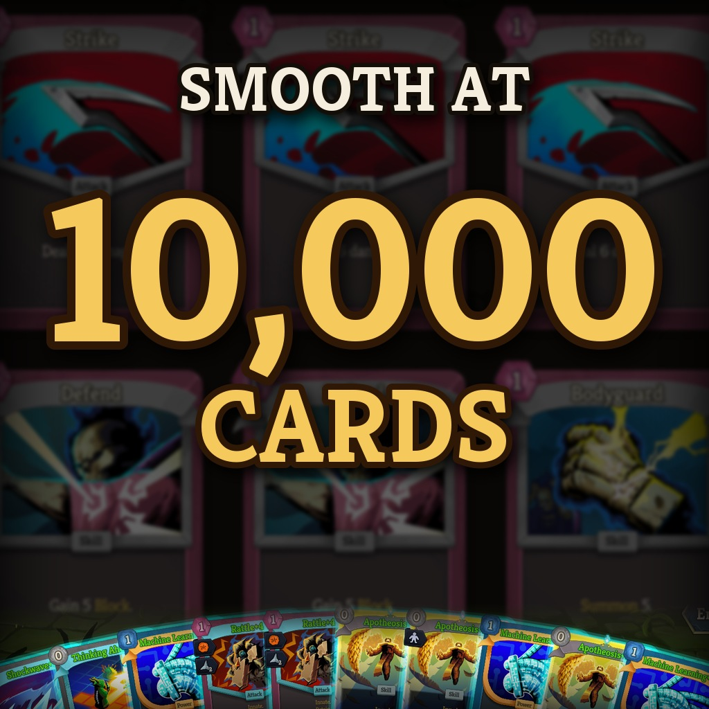

# Big Deck Optimization

Removes the lag of huge decks in Slay the Spire 2: thousands of cards, hundreds of relics, in singleplayer and in co-op.

> **Early development.** I haven't found any bug, but some might still exist. The mod gets regular updates to fix problems and speed things up further.

## What it changes

With a huge deck, the game slows down more and more until every action freezes it. With the mod:

- **Entering a combat:** with 8,000+ cards and hundreds of relics, about 4 seconds instead of half a minute.
- **Playing cards:** smooth again, even past 10,000 cards.
- **Waiting in combat:** no more constant stutter.
- **End of combat:** no more long freeze before the rewards.
- **Co-op:** the long pause after every action is gone. Players with big decks no longer slow down everyone else.
- **Deck view and card grids:** sorting, opening and scrolling are fast again.
- **Lots of relics:** moving the mouse no longer slows the game down.
- **Optional:** with 50+ relics, the relic effects at the start of a combat skip their animation pauses. It looks faster, and the effects stay exactly the same.

**Client side:** the mod only speeds up the game of the player who has it. Each player who installs it gets the speed-up on their own machine.

## What it doesn't change

- **The game itself:** same rules, same results, same saves. The mod only makes the game do the same work faster.
- **Your friends:** they can join you without the mod. They just won't get the speed-up on their side.
- **Your other mods:** it needs no other mod and works alongside Limitless, BetterSpire2, CampfireTrade, ModConfig and Unlimited. If another mod changes the same part of the game, this mod steps aside there.
- **Its safety:** after a game or mod update, any part of the mod that no longer fits turns itself off instead of guessing.

Co-op with very big decks is much better, but not instant: going from one turn to the next can still take a few seconds.

## Install

- **Steam Workshop:** [subscribe](https://steamcommunity.com/sharedfiles/filedetails/?id=3824717727).
- **Manually:** download `BigDeckOptimization-vX.Y.Z.zip` from [Releases](../../releases) and extract it into `Slay the Spire 2/mods/`.

## Settings

Everything is on by default. With [BaseLib](https://steamcommunity.com/sharedfiles/filedetails/?id=3737335127) (optional), each improvement has its own switch in the game's settings, under **Mods → Big Deck Optimization**. Some players have reported problems with BaseLib: this mod works without it, you just won't have that settings menu. You can also use the console (`` ` `` key, `*` or `^` on AZERTY; without BaseLib, these changes last until you quit the game):

- `bdopt` shows what is on.
- `bdopt off` / `bdopt on` turns the whole mod off or back on, without restarting.
- `bdopt fast_combat_start off` turns off just the faster combat start (`bdopt` lists the other names).

## Something looks wrong?

Turn the mod off in its settings (or type `bdopt off` in the console) and try again, then turn it back on. If the problem is still there with the mod off, it doesn't come from this mod. Otherwise, please open an issue saying whether it happens with the mod on, off, or both. Feedback is very welcome!

## Building from source

.NET 9 SDK, Slay the Spire 2 and [BaseLib](https://steamcommunity.com/sharedfiles/filedetails/?id=3737335127) installed (for the settings menu DLL; found in the Workshop folder, elsewhere set `<BaseLibDll>` in `Directory.Build.local.props`), then `dotnet build src/BigDeckOptimization/BigDeckOptimization.csproj -c Debug` (copies the mod into the game's `mods` folder). Debug builds also include test tools ([tools/autotest](tools/autotest/README.md)). `python tools/release/package.py` prepares a release. Design notes and measurements: [DESIGN.md](DESIGN.md).

## License

[MIT](LICENSE).
